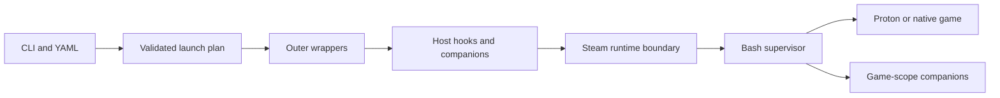

# Architecture and lifecycle

Rust handles CLI, bounded YAML parsing, validation, file storage, planning, the
local editor and the outer child process. A plan keeps inherited Steam argv as
`OsString`, including non-UTF-8 bytes. YAML is UTF-8. Dry-run JSON uses a lossy
display for non-UTF-8 words, but execution preserves them.

A plain launch uses Rust's `Command` without a shell. With hooks/companions, a
generated Bash supervisor runs on the corresponding side of the runtime boundary.
The inner supervisor uses the runtime's Bash rather than the host Rust executable,
avoiding glibc version mismatch. Arguments are individually shell-quoted; no
`eval` or reparsing of an incoming Steam command is used. Scripts are explicit
user code. Generated scripts are limited below Linux's per-argument size limit;
large script bodies should use external script files.

Known executable positions are recognized through supported Steam wrappers; game
arguments are never scanned for strings resembling Proton/runtime executable
names. An opaque command can always be passed through. Advanced manipulation of
an unknown wrapper requires explicit configuration rather than guessed rewriting.

## Lifetime and exit behavior

1. Validate and plan the entire profile before executing anything.
2. Check host executables, acquire an app launch lock, prepare configured compatdata.
3. Run ordered before hooks; start before-game companions and readiness waits.
4. Start the main command; start after-game companions if configured.
5. Observe the main child and required helpers. On exit/signal/failure, terminate
   managed groups, wait a bounded grace period, then kill remaining group members.
6. Run all after hooks with the original `GSR_EXIT_CODE`, each with a timeout.
7. Return the game's status, or a supervision/hook failure. Signals use 128+signal.

Bash job control creates separate process groups without an additional `setsid`
utility. The Rust parent forwards SIGINT, SIGTERM and SIGHUP to its own child
group. Nested supervisors have an additional grace allowance for inner after
hooks. Expired groups are pruned during supervision to limit PID reuse exposure.
Managed programs should run in the foreground; interactive terminal applications
in background task groups are not a supported companion mode.

This is process supervision, not a security sandbox or cgroup manager. A child
that calls `setsid`, double-forks or delegates to an existing daemon can escape
group cleanup. Proton/Wine applications can also delegate to already running
prefix services. GSR never kills a whole wineserver or unrelated processes to
compensate. Use application-specific stop hooks for those programs, with a private
prefix where appropriate. SIGKILL/power loss cannot run after hooks.

## Storage and logs

New configs are written to a private temporary file, synced and linked into place
without replacing an existing profile. GUI writes validate first, take a file
lock, check the original text, save a backup and atomically replace the profile.
External editors do not honor GSR's advisory lock; a simultaneous write in the
final check-to-rename interval cannot be excluded. Avoid editing the same file
concurrently in a text editor and browser. GUI writes through symlinks are rejected.

Lifecycle logs are private by default and rotated per app. Full argv/env are not
logged automatically. Child stdout/stderr remains inherited. Inner diagnostics
append to the same log if its path is mounted inside the runtime, otherwise stderr
still receives them. Custom XDG paths may require explicit pressure-vessel mounts.
Lockfiles are persistent files; their locks are automatically released on exit.

## Local editor boundary

The editor binds only `127.0.0.1` on an ephemeral port. A 256-bit random URL token,
exact Host validation, same-origin validation and a custom request header protect
write routes. CSP blocks remote assets, framing and arbitrary inline scripts.
The server accepts bounded requests, times out reads and stops after 30 idle
minutes. It has no command-execution API. Configuration data is rendered with DOM
text/value operations. Form saves serialize the typed model (removing YAML
comments); raw YAML saves preserve text. Advanced fields survive form edits.

The token grants access to this user's selected configuration; local code running
as the same user can already read it. This is not a multi-user network service.

## Optional virtual filesystem layer

`src/virtual_dirs.rs` resolves versioned external manifests, checks canonical
source/target/storage relationships, and owns the mount-session RAII guard.
Before any configured wrapper/hook starts, foreground fuse-overlayfs services
mount merged trees at private session paths. The outer bubblewrap invocation
binds those trees (or shared source directories) onto existing canonical targets.
The host target is never mounted over. Pressure-vessel receives explicit target
exports and inherits this view. Host-scope tasks also see it.

Write storage holds upper/work and a lock across app IDs; the launch guard lives
until process cleanup finishes. Mount startup is bounded and polled via mountinfo;
unexpected service exit initiates launch shutdown. Setup failure drops the partial
guard. Cleanup lazily unmounts session paths, stops/reaps services and removes only
empty mountpoint directories. It never recursively removes a mounted directory.
Mount services use parent-death signaling; forced kills can still leave stale
state. See [recovery and limitations](virtual-directories.md).

After the direct child exits, the Rust executor now also gives remaining members
of its launch process group TERM plus the configured grace, then KILL. This covers
the surviving same-group reaper observed in playtesting, without globally killing
Wine or changing detached-daemon ownership. Native host companions can opt into a
restored desktop library environment with `host_environment: true`.
